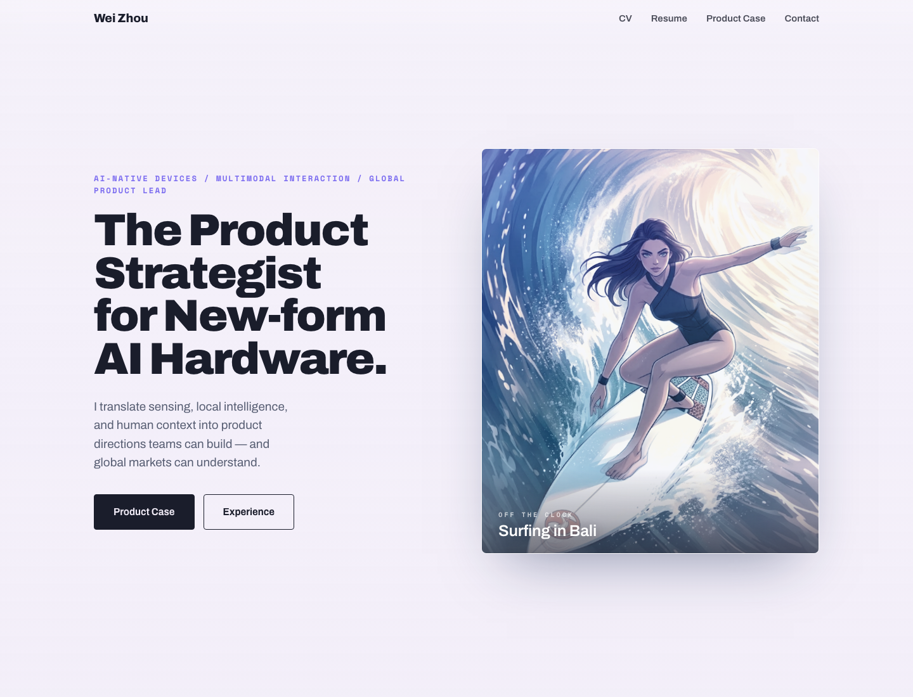

# Wei Zhou — Personal Portfolio

[](https://joyzhou123123.github.io/)

**Live site:** [joyzhou123123.github.io](https://joyzhou123123.github.io/)

Personal portfolio for AI-native devices, multimodal interaction, and global product leadership.  
The site brings together my CV, professional experience, and a product case around ThinkCentre X Tower / Sensor Hub.

## What This Portfolio Covers

- **CV** — concise one-page profile for senior-facing conversations.
- **Resume** — personal experience, career storyline, selected impact, and role positioning.
- **Product Case** — ThinkCentre X Tower / Sensor Hub as a 0-to-1 AI hardware product definition case.

## Positioning

I focus on turning emerging AI capabilities into product directions that teams can build, customers can understand, and global markets can adopt.

Current direction:

- AI-native devices
- Multimodal interaction hardware
- Sensor Hub / ambient sensing
- Local AI workflows
- Global product storytelling

## Featured Case

**ThinkCentre X Tower / Sensor Hub**

A product case on reframing a high-performance desktop into an enterprise local AI workflow entry point, connecting hardware platform design, sensing interaction, local intelligence, enterprise deployment, and GTM narrative.

## Site Structure

```text
index.html          Homepage
cv.html             CV / one-page profile
product-case.html   ThinkCentre X Tower / Sensor Hub case
assets/             Styles, scripts, images, and case materials
```

## Built With

- Plain HTML
- CSS
- JavaScript
- GitHub Pages

No build step is required.
